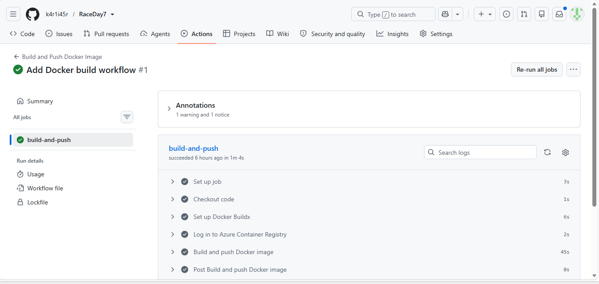
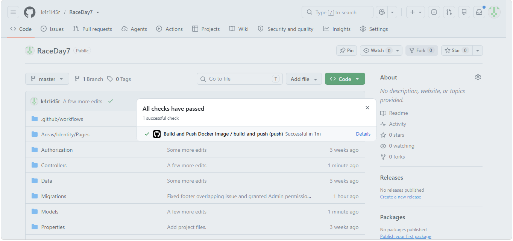
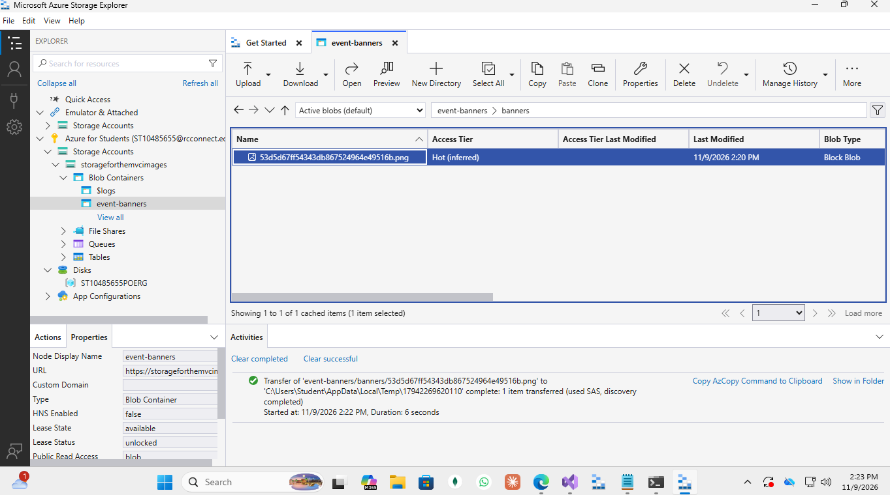
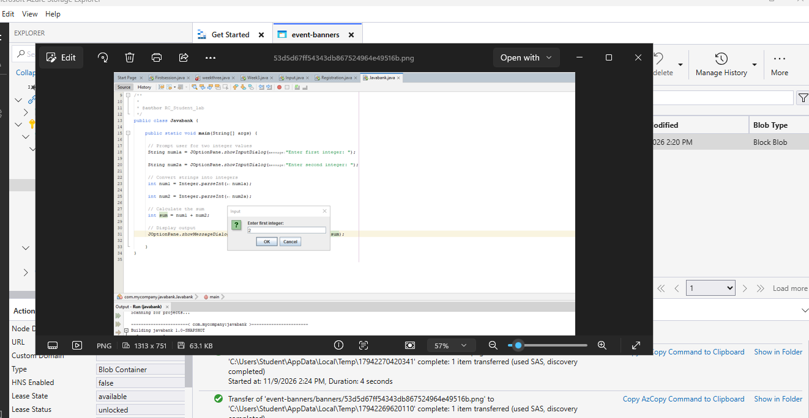
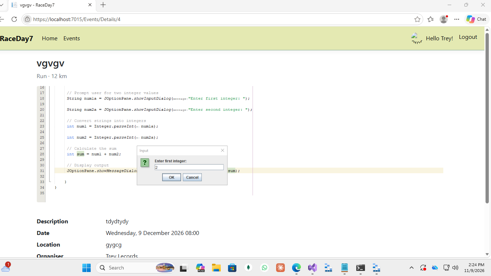

# RaceDay - Event Management System (Part 3)

## Project Description

RaceDay is a full-stack, web-based event management system designed specifically for the South African road running, walking and cycling community.

This repository contains **Part 3** of the Portfolio of Evidence (POE), which focuses on developing the MVC web front-end, integrating Azure Blob Storage for image handling and containerising the application using Docker.

## User Roles

The system supports three distinct user roles:

1. **Participant:** Can browse events, enter events (subject to Organiser approval), view personal performance history and manage their profile.
2. **Organiser:** Can create, edit and delete events, manage categories, approve participant enrolments and capture event results.
3. **Admin:** Has full system access, including user management and the ability to override event permissions.

## Technology Stack

- **Framework:** ASP.NET Core 8.0 (MVC)
- **Database:** SQL Server (Entity Framework Core)
- **Authentication:** ASP.NET Core Identity with custom one-to-one role mapping
- **Cloud Storage:** Azure Blob Storage
- **Containerisation:** Docker
- **CI/CD:** GitHub Actions

## Setup and Run Instructions (Local Development)

Follow these steps to run the application locally:

1. Clone this repository to your local machine.
2. Open the solution in Visual Studio.
3. Ensure that the `appsettings.json` file contains the required SQL Server connection string and Azure Storage connection string.
4. Open the Package Manager Console and execute the following command to apply the database migrations:

   `Update-Database`

5. Press `F5` in Visual Studio to build and run the application.

## Docker Deployment

The application is containerised using a multi-stage `Dockerfile`, located in the root directory of the repository.

The Docker image can be pulled and run using the following command:

```bash
docker run -d -p 8080:8080 --name raceday-container raceday7st10485655.azurecr.io/raceday-app:v1.0.0
```

Once the container is running, the application can be accessed at:

`http://localhost:8080`

## Docker and CI/CD: CloudLabs Environment Workaround

### Challenge

The CloudLabs virtual machine provided for this assignment operates under restricted security policies and does not grant administrator privileges. As a result, Docker Desktop could not be installed and configured locally because it requires administrator access to enable WSL 2 and the Virtual Machine Platform.

Additionally, the Azure for Students subscription restricts the use of direct `az acr build` tasks.

### Solution

To fulfil the containerisation requirement and demonstrate that the application builds successfully inside a Docker container, a CI/CD workflow was implemented using GitHub Actions and Azure Container Registry (ACR).

The following process was implemented:

1. A GitHub Actions workflow was created at `.github/workflows/docker-build.yml`.
2. Whenever changes are pushed to the `main` branch, GitHub Actions automatically starts an Ubuntu runner.
3. The runner builds the Docker image using the project's `Dockerfile`.
4. The successfully built image is pushed to Azure Container Registry.

This cloud-based approach demonstrates that the application can be built and deployed as a Docker image without requiring local administrator privileges.

### CI/CD Evidence

**Successful Docker Build and Push Workflow**



*Evidence of the successful Docker image build and push workflow.*

**GitHub Actions Workflow Verification**



*Evidence of all GitHub Actions checks passing, including the previous Part 2 workflows.*

## Azure Blob Storage Integration

Azure Blob Storage is integrated into the application to allow Organisers to upload event banner images.

Uploaded images are stored in an Azure Storage container, while their corresponding URLs are saved in the SQL Server database. These URLs are then used to display event banner images on the Event Details page.

### Azure Blob Storage Evidence







## Video Demonstration

A YouTube video demonstrates the running application, MVC structure, Azure Blob Storage integration and Docker configuration.

[Watch the Video Demonstration](https://www.youtube.com/@karliarobson17)

## Documentation

All supporting documentation, including the Entity Relationship Diagram (ERD) and SQL database script, is available in the `/docs` folder.

- **ERD:** `race_day_erd (1).pdf`
- **SQL Database Script:** `script.sql-raceday7.sql`

## Repository Structure

```text
RaceDay/
│
├── docs/
│   ├── ci-cd-green-check.png
│   ├── allchecks-part3.png
│   ├── blob1.png
│   ├── blob2.png
│   ├── blob3.png
│   ├── race_day_erd (1).pdf
│   └── script.sql-raceday7.sql
│
├── .github/
│   └── workflows/
│       └── docker-build.yml
│
├── Dockerfile
├── appsettings.json
└── ...
```
