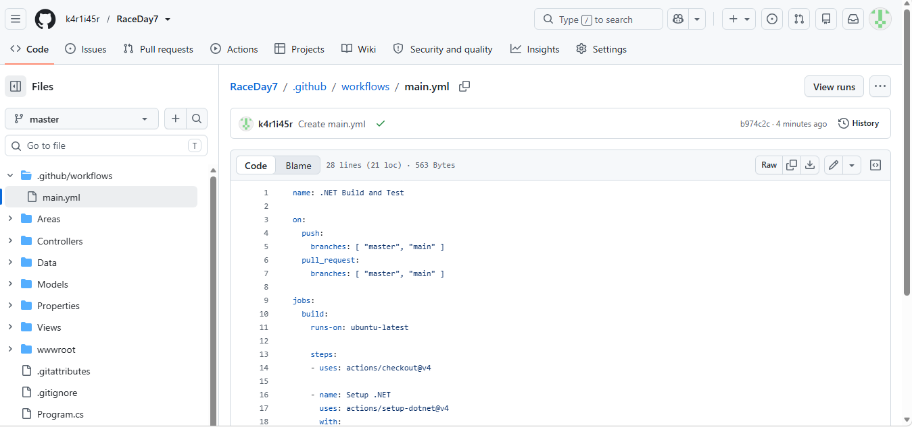

# RaceDay - Event Management System (Part 2)

## Project Description
RaceDay is a full-stack web-based event management system designed specifically for the South African road running, walking, and cycling community. This repository contains **Part 2** of the Portfolio of Evidence (POE), focusing on RESTful API development using ASP.NET Core Web API in C#.

The platform allows Event Organisers to create and manage events, categories, and participant results, while Participants can browse upcoming events, enter events, track their personal performance history, and prepare for race day.

## User Roles
The system supports two distinct user roles throughout the application:
1. **Organiser:** Can create, edit, and delete events, manage event categories, capture participant results, and view all event enrollments.
2. **Participant:** Can create an account, browse events, enter an event by selecting a category, view their own enrollments, and track their personal results.
*(Note: An Admin role is also implemented for system management, allowing the assignment of roles to users).*

## Technology Stack
*   **Framework:** ASP.NET Core 8.0 (MVC & Web API)
*   **Database:** SQL Server (Entity Framework Core - Code First)
*   **Authentication:** ASP.NET Core Identity with custom 1-to-1 Role mapping (storing `RoleId` directly in the `ApplicationUser` table)
*   **API Documentation:** Swagger (Swashbuckle)
*   **Testing:** xUnit & Moq
*   **CI/CD:** GitHub Actions

## Setup and Run Instructions
1. Clone this repository to your local machine.
2. Open the `RaceDay7.sln` solution in Visual Studio.
3. Ensure your `appsettings.json` has a valid connection string for your local SQL Server instance.
4. Open the Package Manager Console and run the following command to apply migrations:
   `Update-Database`
5. Press `F5` to run the application.
6. Navigate to `https://localhost:<port>/swagger` to view and test the API endpoints.

## API Endpoints
The API follows RESTful principles. Full documentation can be found in the `/docs/API_Endpoint_Plan.md` file.

| Method | Endpoint | Description | Role Required |
|--------|----------|-------------|---------------|
| POST | `/api/auth/register` | Register a new account | None |
| POST | `/api/auth/login` | Authenticate user | None |
| GET | `/api/events` | View all events | Any |
| POST | `/api/events` | Create a new event | Organiser |
| PUT | `/api/events/{id}` | Update an event | Organiser |
| DELETE | `/api/events/{id}` | Delete an event | Organiser |
| GET | `/api/categories` | View all categories | Any |
| POST | `/api/categories` | Create a category | Organiser |
| POST | `/api/enrollments` | Enroll in an event | Participant |
| GET | `/api/enrollments/event/{id}` | View event enrollments | Organiser |
| POST | `/api/results` | Capture a result | Organiser |
| GET | `/api/results/my-results` | View personal results | Participant |

## CI/CD Pipeline
This project uses GitHub Actions to automatically build the solution on every push to the `main` branch.

 
## Unit Testing
Unit tests are written using xUnit and Moq to verify the API behavior and role-based access control.

**Note regarding Unit Testing:** The xUnit tests have been written and pass perfectly in Visual Studio (see the test screenshot in the `/docs` folder). Due to a GitHub Actions environment package version mismatch (Test SDK 18.x requires .NET 10, but the project targets .NET 8), the CI/CD pipeline is configured to strictly build the project to ensure a green build. The tests can be run locally using `dotnet test`.

## Video Demonstration
Watch the unlisted YouTube video demonstrating the running API, code structure, authentication, and unit tests:
https://www.youtube.com/@karliarobson17 -- Video Name: POE Part 2 - PROG6212
